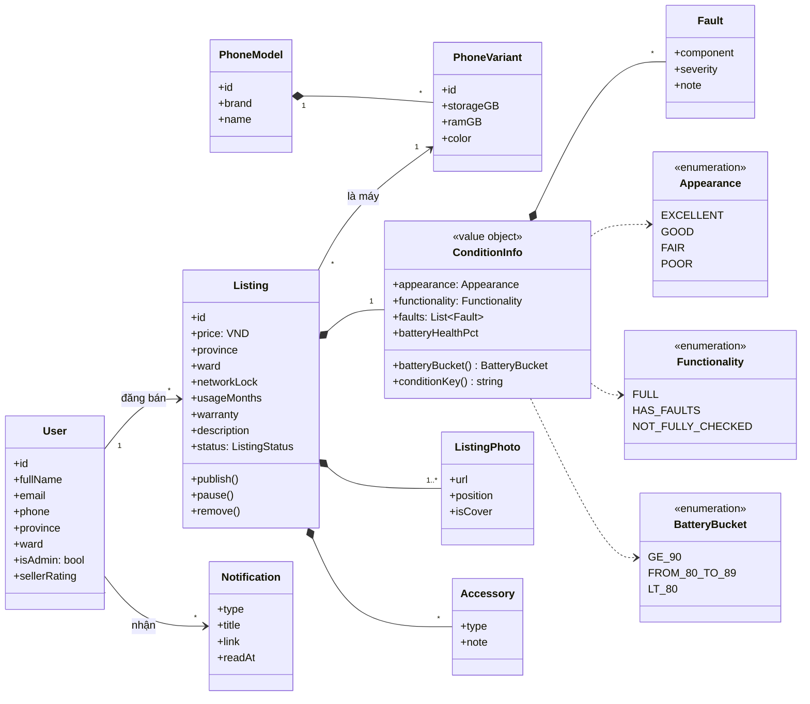
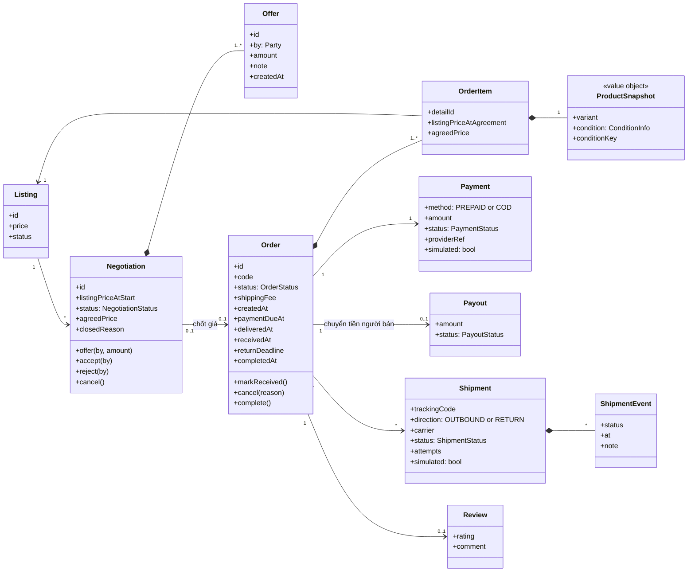
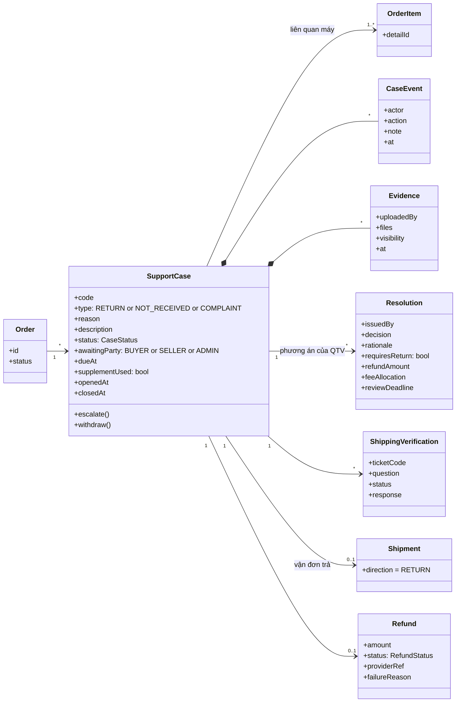
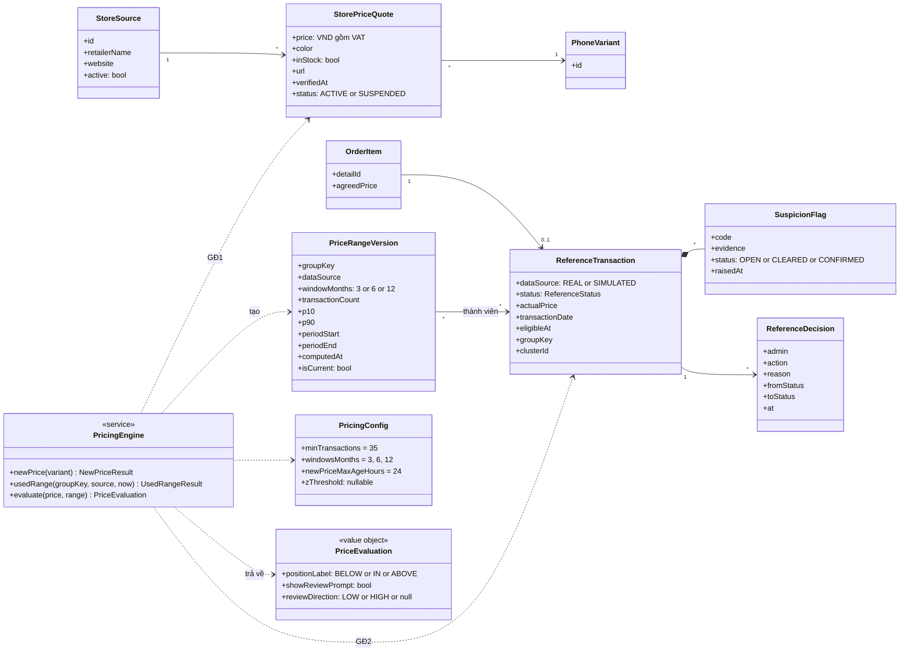

# RePrice — Class diagram

> Bám theo `docs/SPEC.md` (17/10/2026). Bản xem trực quan: artifact "RePrice Domain Model".

## 1. Tài khoản, danh mục máy, tin đăng

Một `User` vừa mua vừa bán. Tình trạng máy là một value object `ConditionInfo`; từ đó suy ra nhóm pin và khóa nhóm Condition Score (3 tiêu chí).

- `conditionKey()` = `appearance | functionality | batteryBucket`. Thiếu một trong ba thì trả rỗng, giao dịch không được ghép nhóm.
- Không có trường lịch sử sửa chữa.

## 2. Thương lượng, đơn hàng, thanh toán, giao hàng

Đơn được tạo khi chốt giá. Mỗi máy trong đơn là một `OrderItem` với giá chốt và snapshot riêng; đây là đơn vị được xét vào dữ liệu giá.

- `Order` có buyer và seller (tham chiếu `User`); bỏ khỏi hình cho gọn.
- `returnDeadline` = `receivedAt` + 3 ngày nếu người mua bấm "Đã nhận hàng", ngược lại `deliveredAt` + 3 ngày.
- `paymentDueAt` = `createdAt` + 24 giờ. Mua ngay thì không có `Negotiation`.
- Trạng thái đơn, thanh toán, chi trả và vận đơn là bốn trường riêng, không gộp vào một `status`.

## 3. Trả hàng, hoàn tiền, khiếu nại

Ba chức năng dùng chung một `SupportCase`. Mỗi đơn chỉ có một hồ sơ đang mở; chuyển từ trả hàng sang khiếu nại giữ nguyên hồ sơ.

- `Resolution` có thể nhiều bản khi bị đề nghị xem xét lại; bản mới nhất có hiệu lực.
- Chỉ hoàn toàn bộ tiền hàng; phí ghi riêng trong `feeAllocation`.

## 4. Giá tham khảo và dữ liệu tham chiếu

`PricingEngine` là service thuần: đọc báo giá cửa hàng (GĐ1) và giao dịch tham chiếu (GĐ2), tạo `PriceRangeVersion` để truy ngược được dải giá tính từ những giao dịch nào.

- `groupKey` = `variantId` + `conditionKey` của snapshot lúc giao dịch.
- Mean, độ lệch chuẩn và giá trị Z chỉ tồn tại trong `evaluate()`, không lưu và không trả ra frontend.
- `clusterId` chỉ là quan hệ dữ liệu, không phải kết luận gian lận.
