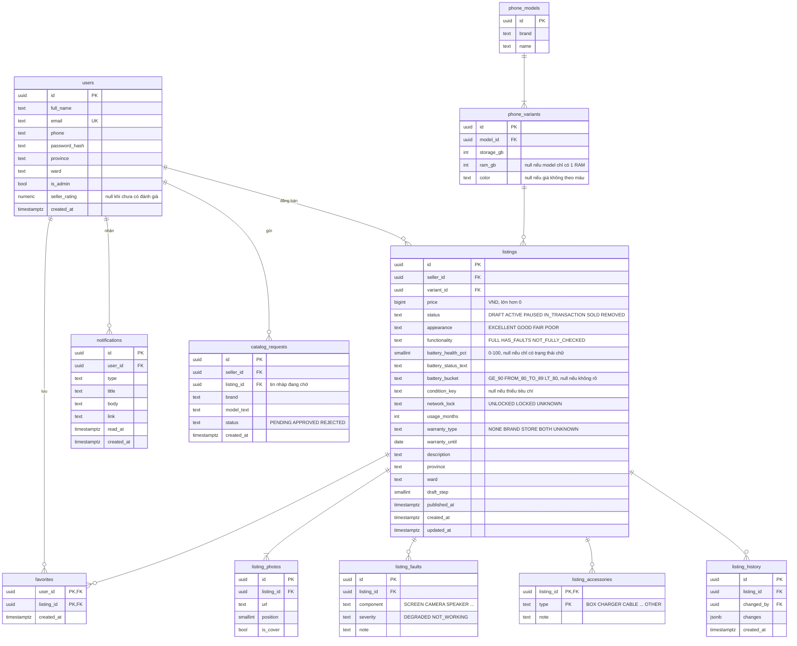
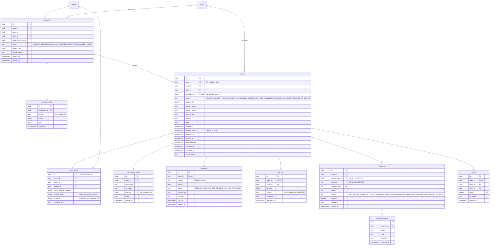
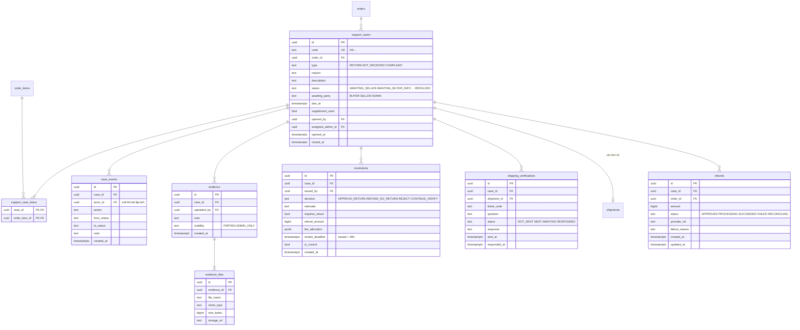

# RePrice — ERD (PostgreSQL)

> Bám theo `docs/SPEC.md` (17/10/2026). Bản xem trực quan: artifact "RePrice Domain Model".

Quy ước chung: khóa chính `uuid`; tiền là `bigint` đơn vị đồng; thời gian là `timestamptz`; trạng thái là `text` có `CHECK` theo đúng giá trị trong state diagram. Bảng ở nhóm khác chỉ hiện tên để nối quan hệ.

## 1. Tài khoản, danh mục, tin đăng

Tình trạng máy nằm thẳng trong `listings` (value object), lỗi chức năng tách sang `listing_faults`.

## 2. Thương lượng, đơn hàng, thanh toán, giao hàng

`order_items.id` chính là mã chi tiết giao dịch. `snapshot` chụp lại phiên bản máy và tình trạng lúc chốt giá; người bán sửa tin sau đó không ảnh hưởng.

## 3. Trả hàng, hoàn tiền, khiếu nại

## 4. Giá tham khảo, dữ liệu tham chiếu, quản trị

`reference_transactions` giữ sẵn `variant_id` và `condition_key` để ghép nhóm nhanh. Fixture demo không có đơn thật nên `order_item_id` được để trống khi `data_source = SIMULATED`.

```mermaid
erDiagram
  store_sources ||--o{ store_price_quotes : ""
  phone_variants ||--o{ store_price_quotes : ""
  order_items ||--o| reference_transactions : ""
  phone_variants ||--o{ reference_transactions : ""
  reference_transactions ||--o{ suspicion_flags : ""
  reference_transactions ||--o{ reference_decisions : ""
  reference_transactions ||--o{ transaction_relations : "a / b"
  price_range_versions ||--|{ price_range_members : ""
  reference_transactions ||--o{ price_range_members : ""
  users ||--o{ admin_audit_logs : "QTV"
  store_sources {
    uuid id PK
    text retailer_name UK
    text website
    bool active
  }
  store_price_quotes {
    uuid id PK
    uuid source_id FK
    uuid variant_id FK
    text color "null nếu giá chung mọi màu"
    bigint price "giá bán hiện tại, gồm VAT"
    bool in_stock
    text url
    timestamptz verified_at
    text status "ACTIVE SUSPENDED"
  }
  reference_transactions {
    uuid id PK
    uuid order_item_id FK,UK "null khi SIMULATED"
    uuid variant_id FK
    text condition_key
    text data_source "REAL SIMULATED"
    text status "PENDING_COMPLETION PENDING_VERIFICATION ELIGIBLE EXCLUDED REVOKED"
    bigint actual_price
    date transaction_date
    timestamptz eligible_at
    uuid cluster_id
    timestamptz updated_at
  }
  suspicion_flags {
    uuid id PK
    uuid reference_transaction_id FK
    text code "PAYMENT_DELIVERY_CONTRADICTION ... ELIGIBLE_THEN_RETURNED"
    text evidence
    text status "OPEN CLEARED CONFIRMED"
    timestamptz raised_at
    timestamptz resolved_at
  }
  reference_decisions {
    uuid id PK
    uuid reference_transaction_id FK
    uuid admin_id FK
    text action "ALLOW KEEP_PENDING EXCLUDE REVOKE REVOKE_RECALC"
    text reason
    text from_status
    text to_status
    timestamptz created_at
  }
  transaction_relations {
    uuid id PK
    uuid a_id FK
    uuid b_id FK
    text relation_type "SAME_ORDER SAME_BUYER SAME_SELLER SAME_DEVICE"
    text basis
  }
  price_range_versions {
    uuid id PK
    uuid variant_id FK
    text condition_key
    text data_source
    text result "RANGE SINGLE_PRICE INSUFFICIENT_DATA NO_DATA"
    smallint window_months "3 6 12"
    int transaction_count
    bigint p10
    bigint p90
    date period_start
    date period_end
    bool is_current
    timestamptz computed_at
  }
  price_range_members {
    uuid version_id PK,FK
    uuid reference_transaction_id PK,FK
  }
  pricing_config {
    text key PK "min_transactions, windows_months, z_threshold ..."
    jsonb value "null = chưa thiết lập"
    uuid updated_by FK
    timestamptz updated_at
  }
  system_clock {
    smallint id PK "luôn = 1"
    bigint offset_seconds "tua thời gian demo"
  }
  admin_audit_logs {
    uuid id PK
    uuid admin_id FK
    text action
    text entity_type
    uuid entity_id
    text reason
    jsonb before
    jsonb after
    timestamptz created_at
  }
```

## 5. Ràng buộc và index quan trọng

| Bảng | Ràng buộc / index | Để làm gì |
|---|---|---|
| `negotiations` | unique (`listing_id`, `buyer_id`) where status in (`AWAITING_SELLER`, `AWAITING_BUYER`) | Một người mua chỉ có một thương lượng đang mở cho mỗi tin |
| `order_items` | unique (`listing_id`) where đơn chưa ở `CANCELLED` / `REFUNDED` (thực hiện bằng khóa hàng trên `listings` khi tạo đơn) | Một máy không bị bán hai lần |
| `orders` | unique `negotiation_id`; index (`status`, `payment_due_at`), (`status`, `return_deadline`) | Một thương lượng chỉ ra một đơn; bộ lập lịch tìm đơn đến hạn |
| `support_cases` | unique (`order_id`) where `closed_at` is null; index (`status`, `due_at`) | Mỗi đơn một hồ sơ đang mở; tìm hồ sơ quá hạn |
| `refunds` | unique (`case_id`) where status in (`APPROVED`, `PROCESSING`, `RECONCILING`) | Không có hai lệnh hoàn chạy song song |
| `reference_transactions` | check: `data_source = 'SIMULATED'` or `order_item_id` not null; index (`variant_id`, `condition_key`, `data_source`, `status`, `transaction_date`) | Dữ liệu thật luôn gắn với một máy đã bán; truy vấn chọn cửa sổ 3 / 6 / 12 tháng |
| `price_range_versions` | unique (`variant_id`, `condition_key`, `data_source`) where `is_current` | Mỗi nhóm máy chỉ có một dải đang công bố |
| `store_price_quotes` | unique (`source_id`, `variant_id`, `color`) | Mỗi chuỗi bán lẻ chỉ góp một giá cho một phiên bản |
| `reviews` | unique `order_id`; check `rating` between 1 and 5 | Mỗi đơn hoàn tất đánh giá một lần |

- Bộ lập lịch đọc giờ hiện tại qua `now() + system_clock.offset_seconds` để nút "Tua thời gian" chạy đúng các hạn 24h, 48h, 3 ngày.
- `pricing_config` chứa các ngưỡng; `z_threshold` để `null` nghĩa là chưa thiết lập, dải giá vẫn hiện, không có lời nhắc.
