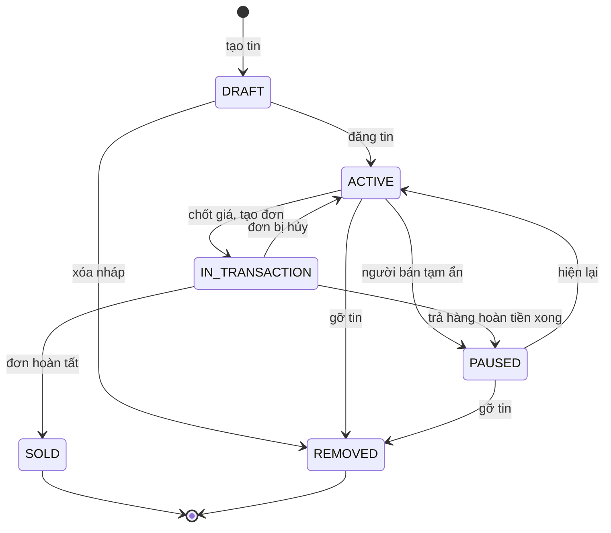
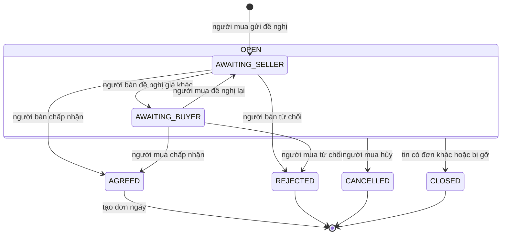
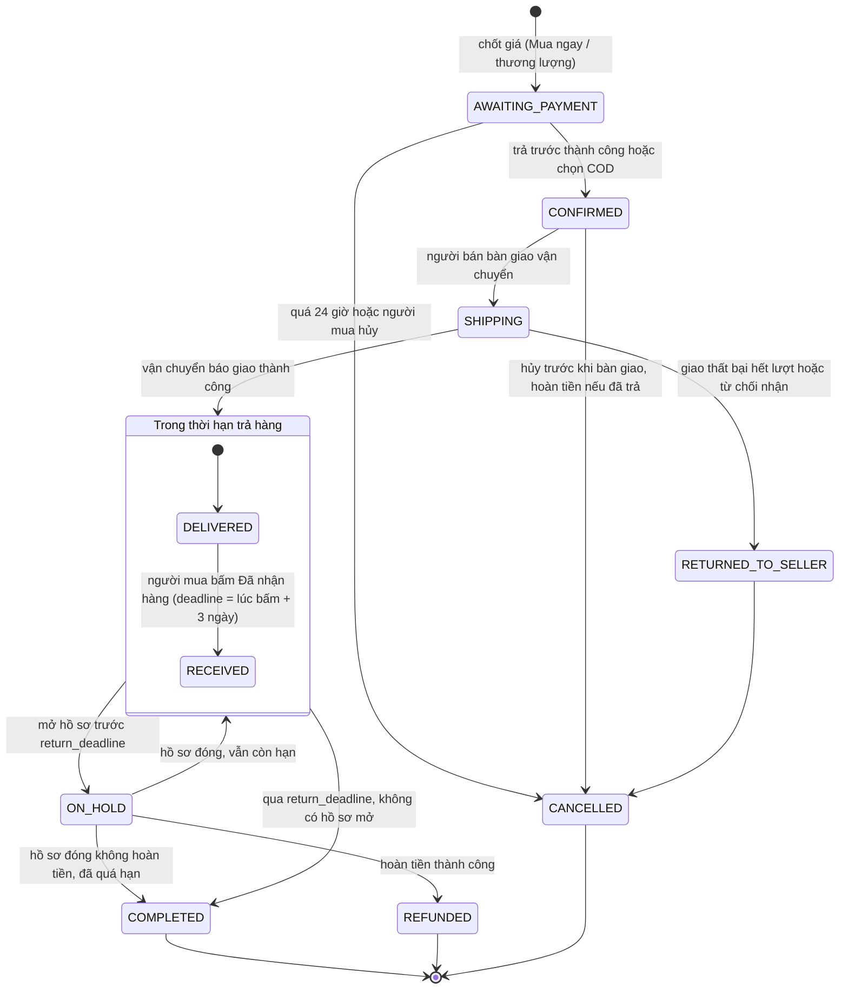
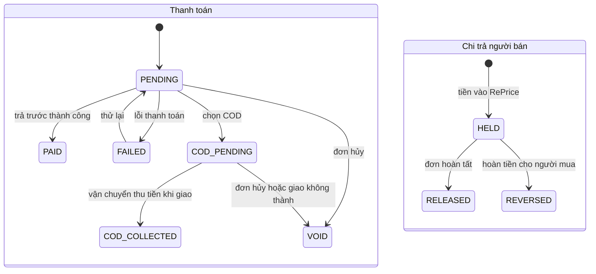
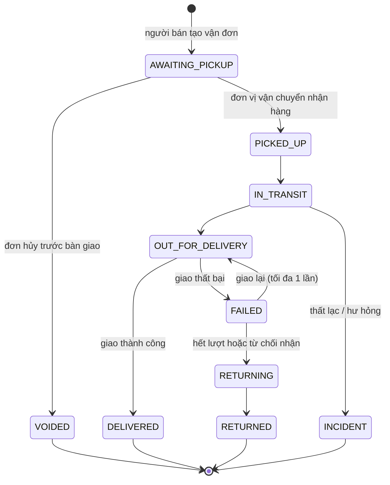
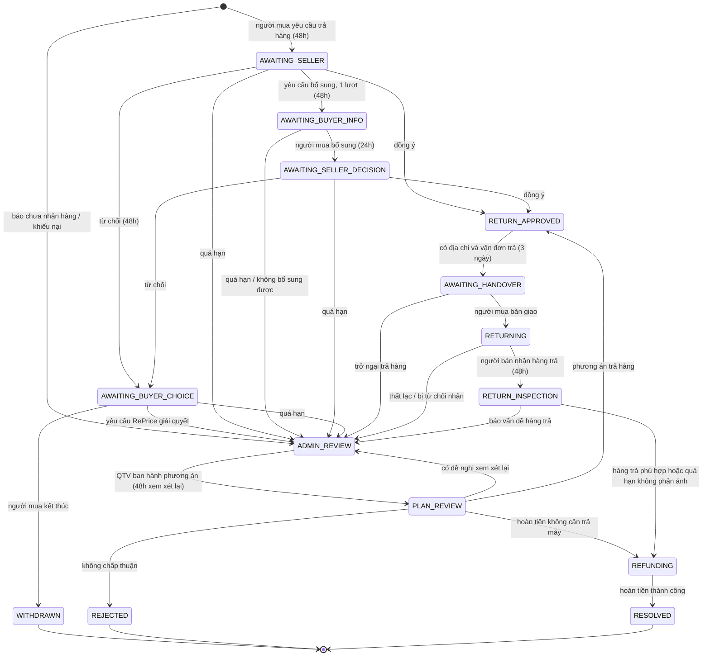
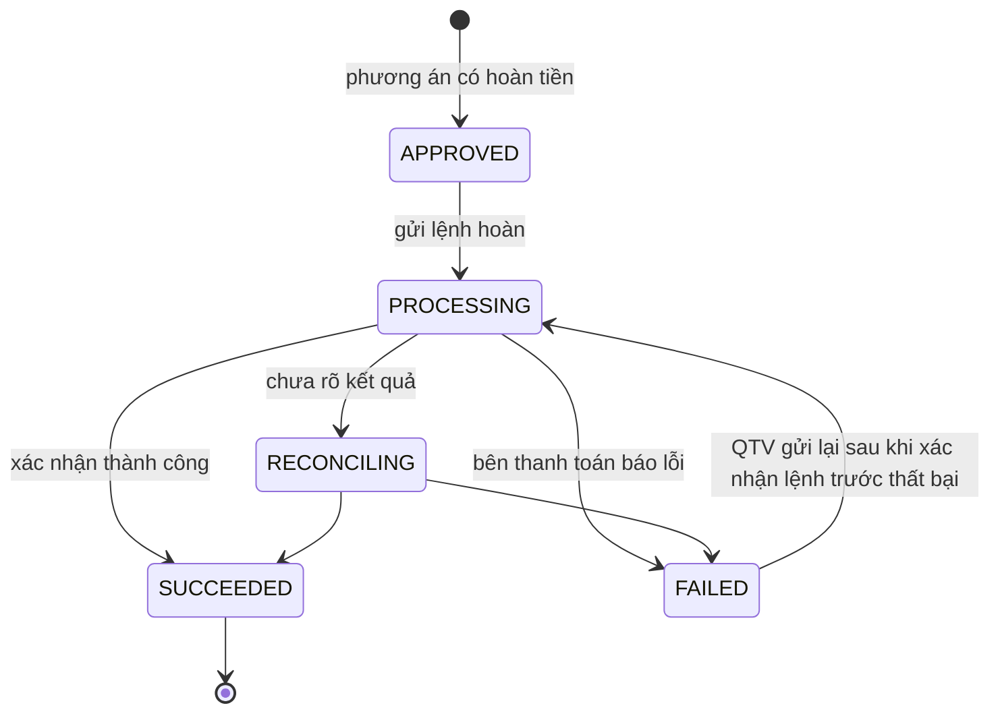
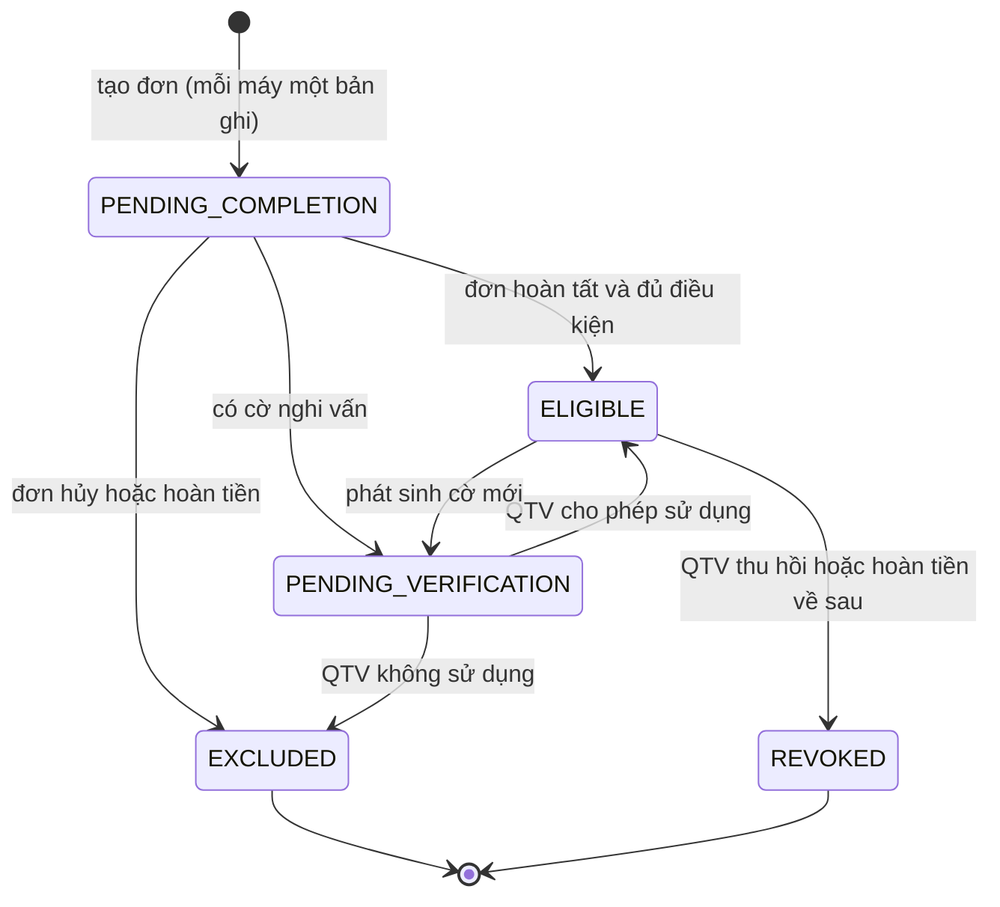

# RePrice — State diagram

> Bám theo `docs/SPEC.md` (17/10/2026). Bản xem trực quan: artifact "RePrice Domain Model".

> **Khác với code hiện tại**
> - Thương lượng: `SELLER_COUNTER` đổi thành `AWAITING_BUYER`; người mua được đề nghị lại.
> - Đơn hàng: bỏ `PENDING_BUYER` và `PENDING_SELLER`; thêm `AWAITING_PAYMENT`, `RECEIVED`, `ON_HOLD`.
> - Tin đăng: thêm `IN_TRANSACTION`.

## 1. Tin đăng `Listing.status`

- Chỉ `ACTIVE` mới hiện trong tìm kiếm và nhận thương lượng mới. Chỉ sửa được khi chưa có đơn.
- Máy bị trả về thì tin sang `PAUSED` để người bán kiểm tra rồi tự đăng lại.

## 2. Thương lượng `Negotiation.status`

- Mỗi lượt đề nghị là một `Offer` mới; không ghi đè lịch sử.
- `REJECTED` không tạo đơn. Người mua có thể mở thương lượng mới nếu tin vẫn `ACTIVE`.

## 3. Đơn hàng `Order.status`

- Hết hạn 24 giờ và qua `return_deadline` do bộ lập lịch ở backend xử lý, không dựa vào trình duyệt.
- Khiếu nại sau khi `COMPLETED` mở hồ sơ hỗ trợ nhưng không đổi trạng thái đơn.

## 4. Thanh toán `Payment.status` và chi trả `Payout.status`

- `Payout` chỉ tạo khi có `PAID` hoặc `COD_COLLECTED`. Hồ sơ đang mở giữ `HELD`.
- Chọn COD không có nghĩa đã thu tiền.

## 5. Vận đơn `Shipment.status`

- Dùng chung cho vận đơn đi (`OUTBOUND`) và vận đơn trả hàng (`RETURN`). Mọi sự kiện gắn nhãn mô phỏng.
- `DELIVERED` của vận đơn đi ghi `Order.deliveredAt`.

## 6. Hồ sơ trả hàng / khiếu nại `SupportCase.status`

- Mỗi trạng thái chờ có `awaitingParty` và `dueAt`; quá hạn thì bộ lập lịch chuyển `ADMIN_REVIEW`, không coi im lặng là đồng ý.
- Người bán chỉ được yêu cầu bổ sung một lượt (`supplementUsed`).
- Hồ sơ còn mở thì đơn ở `ON_HOLD` và chi trả ở `HELD`.

## 7. Hoàn tiền `Refund.status`

- Không gửi lại lệnh khi đang `RECONCILING`, tránh hoàn hai lần.
- COD chưa thu tiền thì không tạo `Refund`.

## 8. Dữ liệu tham chiếu `ReferenceTransaction.status`

- Chỉ `ELIGIBLE` được đếm vào ngưỡng 35, và chỉ khi cùng `groupKey`, cùng `dataSource`, nằm trong cửa sổ được chọn.
- Rời khỏi `ELIGIBLE` thì tính lại các `PriceRangeVersion` có chứa giao dịch đó.
- Mọi chuyển trạng thái do QTV đều ghi `ReferenceDecision` kèm lý do.

## Các trạng thái liên kết với nhau

| Sự kiện | Đơn | Tin | Thanh toán / chi trả | Tham chiếu |
|---|---|---|---|---|
| Chốt giá | `AWAITING_PAYMENT` | `IN_TRANSACTION` | `PENDING` | `PENDING_COMPLETION` |
| Quá 24 giờ chưa trả | `CANCELLED` | `ACTIVE` | `VOID` | `EXCLUDED` |
| Giao thành công | `DELIVERED` | — | `HELD` | — |
| Mở hồ sơ trả hàng | `ON_HOLD` | — | `HELD` | `PENDING_COMPLETION` |
| Hoàn tiền thành công | `REFUNDED` | `PAUSED` | `REVERSED` | `EXCLUDED` |
| Qua `return_deadline`, không hồ sơ | `COMPLETED` | `SOLD` | `RELEASED` | `ELIGIBLE` (nếu không có cờ) |
