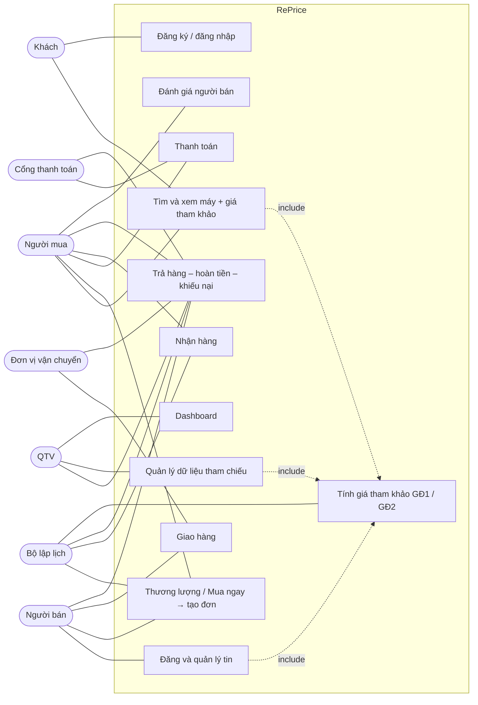

# RePrice — Use case

> Bám theo `docs/SPEC.md`. Mỗi use case có mã để class diagram, state diagram, ERD và API tham chiếu lại.
> Cột "SPEC" chỉ mục trong SPEC chứa quy tắc chi tiết.

## 1. Tác nhân

| Tác nhân | Loại | Ghi chú |
|---|---|---|
| Khách | Người | Chưa đăng nhập |
| Người mua | Người | Tài khoản đã đăng nhập, đang mua |
| Người bán | Người | Cùng loại tài khoản với người mua, đang bán |
| QTV | Người | Quản trị viên |
| Đơn vị vận chuyển | Hệ thống ngoài (mô phỏng) | Cập nhật các mốc giao hàng, giao trả |
| Cổng thanh toán | Hệ thống ngoài (mô phỏng) | Báo kết quả thanh toán, hoàn tiền |
| Bộ lập lịch | Hệ thống nội bộ | Tiến trình backend chạy theo thời gian: hết hạn, tự hoàn tất, tính lại giá |

## 2. Sơ đồ tổng quan

## 3. Danh sách use case

### 3.1. Tài khoản và tìm kiếm

| Mã | Use case | Tác nhân | Tiền điều kiện | Kết quả | SPEC |
|---|---|---|---|---|---|
| UC01 | Đăng ký / đăng nhập / đăng xuất | Khách | — | Có phiên đăng nhập; nếu đang thao tác dở thì quay lại đúng trang | 2 |
| UC02 | Chuyển vai trò demo | Mọi vai trò | Chế độ demo | Đổi sang tài khoản mẫu tương ứng; dữ liệu giữ nguyên | 2, 7 |
| UC03 | Tìm, lọc, sắp xếp điện thoại | Khách, Người mua | — | Danh sách tin `ACTIVE` phù hợp | 3 |
| UC04 | Xem chi tiết điện thoại | Khách, Người mua | Tin đang hiển thị | Thông tin máy, người bán, giá rao, khối GĐ1 + GĐ2 (gọi UC40) | 5 |
| UC05 | Lưu / bỏ yêu thích | Người mua | Đã đăng nhập | Danh sách yêu thích cập nhật | — |
| UC06 | Xem trung tâm thông báo | Người mua, Người bán, QTV | Đã đăng nhập | Danh sách thông báo; bấm vào mở đúng đối tượng | — |
| UC07 | Quản lý hồ sơ cá nhân | Người mua, Người bán | Đã đăng nhập | Thông tin tài khoản cập nhật | — |

### 3.2. Đăng tin

| Mã | Use case | Tác nhân | Tiền điều kiện | Kết quả | SPEC |
|---|---|---|---|---|---|
| UC10 | Đăng tin bán (wizard 5 bước) | Người bán | Đã đăng nhập | Tin `ACTIVE`; ở bước giá hiện GĐ1 + GĐ2 (gọi UC40) với dấu "Giá bạn nhập" | 3.1 |
| UC11 | Lưu nháp / tiếp tục nháp | Người bán | Đang đăng tin | Tin `DRAFT`, nhớ bước đang làm | 3.1 |
| UC12 | Yêu cầu bổ sung model vào danh mục | Người bán | Không tìm thấy model | Yêu cầu chờ QTV; tin giữ ở nháp | 3.1 |
| UC13 | Sửa tin | Người bán | Tin chưa có đơn | Tin cập nhật, lưu lịch sử thay đổi | 3.1 |
| UC14 | Tạm ẩn / gỡ tin | Người bán | Tin chưa có đơn | Tin `PAUSED` / `REMOVED`; thương lượng đang mở bị đóng | 3.2 |

### 3.3. Thương lượng và tạo đơn

| Mã | Use case | Tác nhân | Tiền điều kiện | Kết quả | SPEC |
|---|---|---|---|---|---|
| UC20 | Mua ngay | Người mua | Tin `ACTIVE`, không phải tin của mình | Tạo đơn với giá chốt = giá rao (gọi UC24) | 3.2 |
| UC21 | Gửi đề nghị giá | Người mua | Tin `ACTIVE` | Thương lượng mở, chờ người bán | 3.2 |
| UC22 | Phản hồi đề nghị: chấp nhận / từ chối / đề nghị giá khác | Người bán | Đang chờ người bán | Chấp nhận → UC24; từ chối → đóng; đề nghị khác → chờ người mua | 3.2 |
| UC23 | Phản hồi giá người bán: chấp nhận / từ chối / đề nghị lại | Người mua | Đang chờ người mua | Chấp nhận → UC24; từ chối → đóng; đề nghị lại → chờ người bán | 3.2 |
| UC24 | Tạo đơn khi chốt giá | Hệ thống | Giá đã chốt (UC20, UC22, UC23) | Đơn chờ thanh toán; tin → Đang giao dịch; các thương lượng khác của tin đóng và thông báo | 3.2 |
| UC25 | Hủy thương lượng | Người mua | Thương lượng đang mở | Thương lượng đóng | 3.2 |

### 3.4. Đơn hàng, thanh toán, giao hàng

| Mã | Use case | Tác nhân | Tiền điều kiện | Kết quả | SPEC |
|---|---|---|---|---|---|
| UC30 | Chọn phương thức thanh toán và thanh toán | Người mua, Cổng thanh toán | Đơn chờ thanh toán | Trả trước: đã thanh toán; COD: chờ thu COD | 3.3 |
| UC31 | Tự hủy đơn chưa thanh toán sau 24 giờ | Bộ lập lịch | Quá 24 giờ chưa thanh toán | Đơn hủy; tin mở bán lại | 3.2 |
| UC32 | Hủy đơn | Người mua, Người bán | Chưa bàn giao vận chuyển | Đơn hủy; hoàn tiền nếu đã trả trước; tin mở bán lại | 3.4 |
| UC33 | Chuẩn bị và bàn giao hàng | Người bán | Đã thanh toán hoặc COD | Có mã vận đơn; chờ vận chuyển lấy hàng | 3.4 |
| UC34 | Cập nhật mốc vận chuyển | Đơn vị vận chuyển | Có vận đơn | Lịch sử mốc; giao thành công → ghi `delivered_at`, thu COD nếu có | 3.4 |
| UC35 | Xử lý giao thất bại (giao lại / hoàn hàng) | Đơn vị vận chuyển, Người bán | Giao thất bại | Giao lại hoặc hoàn hàng về người bán | 3.4 |
| UC36 | Theo dõi đơn hàng | Người mua, Người bán | Có đơn | Xem giá rao, giá chốt, phí, trạng thái đơn / tiền / giao hàng / hồ sơ | 3 |
| UC37 | Bấm "Đã nhận hàng" | Người mua | Đã giao thành công | Ghi `received_at`; `return_deadline` = `received_at` + 3 ngày | 3.5 |
| UC38 | Tự hoàn tất đơn | Bộ lập lịch | Qua `return_deadline`, không có hồ sơ mở | Đơn hoàn tất; chuyển tiền người bán; giao dịch vào xét dữ liệu tham chiếu (UC52) | 3.5 |
| UC39 | Đánh giá người bán | Người mua | Đơn hoàn tất, chưa đánh giá | Lưu đánh giá, cập nhật điểm người bán | — |

### 3.5. Giá tham khảo

| Mã | Use case | Tác nhân | Tiền điều kiện | Kết quả | SPEC |
|---|---|---|---|---|---|
| UC40 | Lấy giá tham khảo cho một máy + một mức giá | Hệ thống (gọi từ UC04, UC10) | Có model, dung lượng, tình trạng | GĐ1 (`NO_DATA` / `SINGLE_PRICE` / `RANGE`), GĐ2 (`NO_DATA` / `INSUFFICIENT_DATA` / `RANGE`), nhãn vị trí, có/không lời nhắc | 5 |
| UC41 | Cập nhật giá máy mới từ nhà bán lẻ | Bộ lập lịch, QTV | — | Báo giá mới / hết hàng / quá 24 giờ → tính lại GĐ1 | 5.1 |
| UC42 | Xem tập dữ liệu so sánh / giá từng cửa hàng | Khách, Người mua, Người bán | Khối giá có dữ liệu | Danh sách nguồn GĐ1; số giao dịch, khoảng thời gian GĐ2 | 5 |

### 3.6. Trả hàng – hoàn tiền – khiếu nại

| Mã | Use case | Tác nhân | Tiền điều kiện | Kết quả | SPEC |
|---|---|---|---|---|---|
| UC50 | Yêu cầu trả hàng / hoàn tiền | Người mua | Trước `return_deadline`, chưa có hồ sơ mở | Hồ sơ chờ người bán (48 giờ); tạm dừng hoàn tất và chuyển tiền | 4 |
| UC51 | Báo chưa nhận được hàng | Người mua | Đã có `delivered_at` | Hồ sơ chuyển QTV xác minh vận chuyển | 4 |
| UC53 | Phản hồi yêu cầu: đồng ý / từ chối / yêu cầu bổ sung (1 lượt) | Người bán | Hồ sơ chờ người bán | Đồng ý → UC57; từ chối → chờ người mua chọn; bổ sung → chờ người mua | 4 |
| UC54 | Bổ sung thông tin / bằng chứng | Người mua | Được yêu cầu bổ sung | Người bán có 24 giờ quyết định | 4 |
| UC55 | Chuyển khiếu nại lên QTV hoặc rút yêu cầu | Người mua | Bị người bán từ chối | Khiếu nại → QTV; rút → hồ sơ đóng, đơn tiếp tục | 4 |
| UC56 | Xử lý hồ sơ khiếu nại | QTV | Hồ sơ ở QTV | Yêu cầu bổ sung, xác minh vận chuyển, ban hành phương án (trả hàng / hoàn không cần trả / không chấp thuận) | 4 |
| UC57 | Gửi trả hàng | Người mua, Đơn vị vận chuyển | Được chấp thuận trả, có địa chỉ + vận đơn | Hàng trả đang vận chuyển (hạn bàn giao 3 ngày) | 4 |
| UC58 | Kiểm tra hàng trả | Người bán | Đã nhận hàng trả | Phù hợp → UC59; có vấn đề → QTV; quá 48 giờ → tiếp tục hoàn | 4 |
| UC59 | Thực hiện hoàn tiền | QTV, Cổng thanh toán | Đủ điều kiện hoàn | Đã duyệt → Đang xử lý → Thành công / Thất bại / Chờ đối soát | 4 |
| UC60 | Đề nghị xem xét lại kết quả | Người mua, Người bán | Trong 48 giờ sau phương án | QTV xem xét lại | 4 |
| UC61 | Gửi khiếu nại / hỗ trợ sau khi đơn hoàn tất | Người mua | Đơn đã hoàn tất | Hồ sơ hỗ trợ; hiển thị đúng trạng thái tiền đã chuyển | 3.5 |
| UC62 | Chuyển hồ sơ quá hạn lên QTV | Bộ lập lịch | Một bên quá hạn phản hồi | Hồ sơ chuyển QTV, thông báo các bên | 4 |

### 3.7. Dữ liệu tham chiếu và quản trị

| Mã | Use case | Tác nhân | Tiền điều kiện | Kết quả | SPEC |
|---|---|---|---|---|---|
| UC52 | Xét trạng thái dữ liệu tham chiếu | Bộ lập lịch | Đơn / hồ sơ / quyết định QTV thay đổi | Cập nhật `reference_status` từng máy; gắn cờ nghi vấn; cập nhật cụm; tính lại dải bị ảnh hưởng | 6 |
| UC70 | Xem danh sách giao dịch tham chiếu | QTV | — | Lọc theo trạng thái, cờ, cụm, model, nhóm Condition Score, thời gian; xem snapshot và lịch sử quyết định | 6 |
| UC71 | Ra quyết định dữ liệu: cho phép / chờ / không dùng / thu hồi / thu hồi và tính lại | QTV | Có lý do | `reference_status` đổi; ghi nhật ký; tính lại dải nếu cần | 6.4 |
| UC72 | Xem dashboard | QTV | — | Số tài khoản, tin, đơn theo trạng thái, giao dịch hợp lệ / chờ / loại, trạng thái GĐ1 / GĐ2, cảnh báo | — |
| UC73 | Quản lý danh mục máy và nguồn bán lẻ | QTV | — | Thêm model / phiên bản; thêm, tắt nguồn GĐ1 | 5.1 |
| UC74 | Cấu hình ngưỡng giá (`zThreshold`, …) | QTV | — | Lưu cấu hình; để trống hiện "Chưa thiết lập" | 5.4 |
| UC75 | Quản lý tài khoản và tin đăng | QTV | — | Tra cứu, ẩn tin vi phạm (ghi lý do) | — |
| UC76 | Tua thời gian demo | QTV | Chế độ demo | Đồng hồ hệ thống tiến thêm; bộ lập lịch chạy các hạn đến hạn | 3.5, 7 |

## 4. Kịch bản demo xuyên suốt → use case

| Bước | Use case |
|---|---|
| Người bán đăng iPhone 13 128GB | UC10 → UC40 |
| Người mua xem máy, gửi đề nghị | UC03 → UC04 → UC21 |
| Người bán đề nghị giá khác, người mua chấp nhận | UC22 → UC23 → UC24 |
| Người mua thanh toán | UC30 |
| Người bán bàn giao, vận chuyển giao thành công | UC33 → UC34 |
| Người mua bấm "Đã nhận hàng", tua 3 ngày | UC37 → UC76 → UC38 |
| Giao dịch thành `ELIGIBLE`, QTV kiểm tra | UC52 → UC70 → UC71 |
| Demo thuật toán với fixture 42 giao dịch: 3 ca giá | UC04 / UC40 |
